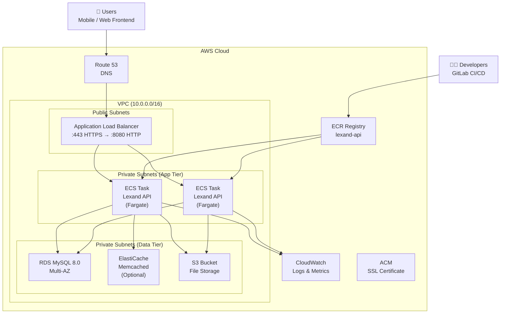

# 🚀 AWS Deployment Guide

## Table of Contents

1. [Architecture Overview](#1-architecture-overview)
2. [Prerequisites](#2-prerequisites)
3. [Manual Deployment](#3-manual-deployment)
   - [3.1 Build and Push Docker Image to ECR](#31-build-and-push-docker-image-to-ecr)
   - [3.2 Create RDS MySQL Database](#32-create-rds-mysql-database)
   - [3.3 Create S3 Bucket for File Storage](#33-create-s3-bucket-for-file-storage)
   - [3.4 Create ECS Cluster](#34-create-ecs-cluster)
   - [3.5 Configure IAM Roles](#35-configure-iam-roles)
   - [3.6 Create Task Definition](#36-create-task-definition)
   - [3.7 Create Application Load Balancer](#37-create-application-load-balancer)
   - [3.8 Configure Security Groups](#38-configure-security-groups)
   - [3.9 Create ECS Service](#39-create-ecs-service)
4. [Environment Variables](#4-environment-variables)
5. [CI/CD Pipeline](#5-cicd-pipeline)
6. [Health Checks & Monitoring](#6-health-checks--monitoring)
7. [Troubleshooting](#7-troubleshooting)
8. [Cost Optimization](#8-cost-optimization)

---

## 1. Architecture Overview



### AWS Services Used

| Service | Purpose | Cost Tier |
|---------|---------|-----------|
| **ECS Fargate** | Container runtime for the API | Pay per use |
| **RDS MySQL 8.0** | Primary database | db.t3.medium+ |
| **Application Load Balancer** | HTTP/HTTPS routing | $0.0225/LCU + traffic |
| **ECR** | Docker image storage | $0.09/GB/mo storage |
| **S3** | File storage (delivery proofs, PDFs) | $0.023/GB/mo |
| **CloudWatch** | Logs and metrics | $0.50/GB ingested |
| **Route 53** | DNS management | $0.50/hosted zone + queries |
| **ACM** | SSL certificates | Free |
| **Secrets Manager** | Environment secrets | $0.40/secret + access |

### Estimated Monthly Cost (Production)

| Component | Instance | Est. Monthly |
|-----------|----------|-------------|
| ECS Fargate | 2 tasks, 2 vCPU, 4GB | $80 - $150 |
| RDS MySQL | db.t3.medium Multi-AZ | $120 - $180 |
| ALB | ~10GB traffic/day | $15 - $30 |
| ECR | ~2GB image | $0.18 |
| S3 | ~10GB storage | $0.23 |
| CloudWatch | ~5GB logs | $2.50 |
| Secrets Manager | 5 secrets | $2.00 |
| Route 53 | 1 hosted zone | $0.50 |
| **Total** | | **~$220 - $385/mo** |

---

## 2. Prerequisites

### Required Tools

```bash
# AWS CLI v2
curl "https://awscli.amazonaws.com/AWSCLIV2.pkg" -o "AWSCLIV2.pkg"
sudo installer -pkg AWSCLIV2.pkg -target /
aws --version  # Should be 2.x

# Docker
docker --version        # Should be 20.10+
docker compose version  # Should be 2.x

# jq (for JSON parsing)
brew install jq

# GitLab CLI (optional, for CI/CD)
glab auth login
```

### AWS Configuration

```bash
# Configure AWS credentials
aws configure

# Verify credentials
aws sts get-caller-identity

# Set default region
aws configure set region us-east-1
```

### Required IAM Permissions

Your IAM user/role needs permissions for:
- `ecs:*` — ECS cluster management
- `ecr:*` — ECR image repository
- `rds:*` — Database management
- `s3:*` — S3 bucket access
- `iam:*` — Role management
- `elasticloadbalancing:*` — ALB management
- `secretsmanager:*` — Secrets management
- `cloudwatch:*` — CloudWatch logs
- `route53:*` — DNS (if using Route 53)

---

## 3. Manual Deployment

### 3.1 Build and Push Docker Image to ECR

#### Step 1: Create ECR Repository

```bash
# Variables
AWS_REGION="us-east-1"
ECR_REPO="lexand-api"
IMAGE_TAG="latest"

# Create ECR repository
aws ecr create-repository \
    --repository-name ${ECR_REPO} \
    --region ${AWS_REGION} \
    --image-scanning-configuration scanOnPush=true \
    --encryption-configuration encryptionType=AES256

# Get ECR URL
ECR_URL=$(aws ecr describe-repositories \
    --repository-names ${ECR_REPO} \
    --region ${AWS_REGION} \
    --query 'repositories[0].repositoryUri' \
    --output text)

echo "ECR URL: ${ECR_URL}"
```

#### Step 2: Authenticate Docker to ECR

```bash
aws ecr get-login-password --region ${AWS_REGION} | \
    docker login --username AWS \
    --password-stdin ${ECR_URL}
```

#### Step 3: Build Docker Image

```bash
# Build for production (multi-stage for smaller image)
docker build \
    --build-arg SPRING_PROFILES_ACTIVE=production \
    -t ${ECR_REPO}:${IMAGE_TAG} \
    -f Dockerfile \
    .

# Tag with ECR URL
docker tag ${ECR_REPO}:${IMAGE_TAG} ${ECR_URL}:${IMAGE_TAG}

# Push to ECR
docker push ${ECR_URL}:${IMAGE_TAG}

# Verify image is in ECR
aws ecr list-images --repository-name ${ECR_REPO} --region ${AWS_REGION}
```

> **Note**: The `Dockerfile` already exists in the project root and uses multi-stage builds for an optimized production image (~200MB vs ~800MB uncompressed).

---

### 3.2 Create RDS MySQL Database

#### Step 1: Create Parameter Group (MySQL 8.0)

```bash
aws rds create-db-parameter-group \
    --db-parameter-group-name lexand-mysql80 \
    --db-parameter-group-family mysql8.0 \
    --description "Lexand API MySQL 8.0 parameters" \
    --region ${AWS_REGION}

# Configure MySQL 8.0 specific parameters
aws rds modify-db-parameter-group \
    --db-parameter-group-name lexand-mysql80 \
    --parameters '
    [
        {"ParameterName": "character_set_server", "ParameterValue": "utf8mb4", "ApplyMethod": "pending-reboot"},
        {"ParameterName": "collation_server", "ParameterValue": "utf8mb4_unicode_ci", "ApplyMethod": "pending-reboot"},
        {"ParameterName": "max_connections", "ParameterValue": "500", "ApplyMethod": "dynamic"},
        {"ParameterName": "innodb_buffer_pool_size", "ParameterValue": "1073741824", "ApplyMethod": "pending-reboot"}
    ]' \
    --region ${AWS_REGION}
```

#### Step 2: Create Option Group

```bash
aws rds create-option-group \
    --option-group-name lexand-mysql80 \
    --engine-name mysql \
    --major-engine-version 8.0 \
    --description "Lexand API MySQL 8.0 options" \
    --region ${AWS_REGION}

# Enable MySQL Backint for backups (optional)
aws rds add-option-to-option-group \
    --option-group-name lexand-mysql80 \
    --options OptionName=MYSQL_ABORT_LOG,ApplyMethod=immediate \
    --region ${AWS_REGION}
```

#### Step 3: Create Subnet Group

```bash
# Assuming VPC has 3 private subnets
VPC_ID="vpc-0123456789abcdef0"
SUBNET1="subnet-0123456789abcdef1"
SUBNET2="subnet-0123456789abcdef2"
SUBNET3="subnet-0123456789abcdef3"

aws rds create-db-subnet-group \
    --db-subnet-group-name lexand-db-subnet-group \
    --db-subnet-group-description "Lexand API DB Subnet Group" \
    --subnet-ids ${SUBNET1} ${SUBNET2} ${SUBNET3} \
    --tags Key=Application,Value=lexand-api \
    --region ${AWS_REGION}
```

#### Step 4: Create RDS Instance

```bash
DB_PASSWORD="YourSecurePassword123!"

aws rds create-db-instance \
    --db-instance-identifier lexand-mysql \
    --db-instance-class db.t3.medium \
    --engine mysql \
    --engine-version 8.0.35 \
    --master-username lexand_admin \
    --master-user-password "${DB_PASSWORD}" \
    --db-name lexand_db \
    --db-subnet-group-name lexand-db-subnet-group \
    --vpc-security-group-ids sg-0123456789abcdef0 \
    --db-parameter-group-name lexand-mysql80 \
    --option-group-name lexand-mysql80 \
    --allocated-storage 100 \
    --max-allocated-storage 500 \
    --storage-encrypted \
    --storage-type gp3 \
    --multi-az \
    --backup-retention-period 7 \
    --preferred-backup-window "03:00-04:00" \
    --preferred-maintenance-window "mon:04:00-mon:05:00" \
    --auto-minor-version-upgrade \
    --enable-performance-insights \
    --performance-insights-retention-period 7 \
    --enable-cloudwatch-logs-exports '["error","general","slowquery"]' \
    --tags Key=Application,Value=lexand-api \
    --region ${AWS_REGION}

# Wait for DB to be available (~10-15 minutes)
aws rds wait db-instance-available --db-instance-identifier lexand-mysql --region ${AWS_REGION}

# Get DB endpoint
DB_ENDPOINT=$(aws rds describe-db-instances \
    --db-instance-identifier lexand-mysql \
    --query 'DBInstances[0].Endpoint.Address' \
    --output text)

echo "DB Endpoint: ${DB_ENDPOINT}"
```

#### Step 5: Store Credentials in Secrets Manager

```bash
# Store DB credentials
aws secretsmanager create-secret \
    --name lexand-api/db-credentials \
    --description "Lexand API database credentials" \
    --secret-string '{
        "username": "lexand_admin",
        "password": "'"${DB_PASSWORD}"'",
        "engine": "mysql",
        "host": "'"${DB_ENDPOINT}"'",
        "port": 3306,
        "dbname": "lexand_db"
    }' \
    --region ${AWS_REGION}

# Store application secrets
aws secretsmanager create-secret \
    --name lexand-api/app-secrets \
    --description "Lexand API application secrets" \
    --secret-string '{
        "jwt_secret": "YourSecureJWTSecretKeyThatIsAtLeast256BitsLongForHS256AlgorithmSecurity",
        "jwt_access_token_expiration": "900000",
        "jwt_refresh_token_expiration": "604800000"
    }' \
    --region ${AWS_REGION}
```

> **Security Note**: Never commit real passwords or secrets to the codebase. Use AWS Secrets Manager or Parameter Store for all sensitive configuration.

---

### 3.3 Create S3 Bucket for File Storage

```bash
S3_BUCKET="lexand-api-files-${AWS_REGION}"
S3_REGION="us-east-1"

# Create S3 bucket
aws s3 mb s3://${S3_BUCKET} --region ${S3_REGION}

# Configure bucket versioning
aws s3api put-bucket-versioning \
    --bucket ${S3_BUCKET} \
    --versioning-configuration Status=Enabled

# Configure server-side encryption
aws s3api put-bucket-encryption \
    --bucket ${S3_BUCKET} \
    --server-side-encryption-configuration '{
        "Rules": [
            {
                "ApplyServerSideEncryptionByDefault": {
                    "SSEAlgorithm": "AES256"
                },
                "BucketKeyEnabled": true
            }
        ]
    }'

# Configure lifecycle rules (move old files to Glacier after 90 days)
aws s3api put-bucket-lifecycle-configuration \
    --bucket ${S3_BUCKET} \
    --lifecycle-configuration '{
        "Rules": [
            {
                "ID": "DeleteOldFiles",
                "Status": "Enabled",
                "Filter": {"Prefix": "delivery-proofs/"},
                "Expiration": {"Days": 365},
                "NoncurrentVersionExpiration": {"NoncurrentDays": 30}
            },
            {
                "ID": "InvoicePDFs",
                "Status": "Enabled",
                "Filter": {"Prefix": "invoices/"},
                "Expiration": {"Days": 90},
                "NoncurrentVersionExpiration": {"NoncurrentDays": 7}
            }
        ]
    }'

# Create IAM policy for S3 access
cat > /tmp/s3-policy.json << 'EOF'
{
    "Version": "2012-10-17",
    "Statement": [
        {
            "Effect": "Allow",
            "Action": [
                "s3:GetObject",
                "s3:PutObject",
                "s3:DeleteObject"
            ],
            "Resource": "arn:aws:s3:::S3_BUCKET_PLACEHOLDER/*"
        },
        {
            "Effect": "Allow",
            "Action": [
                "s3:ListBucket"
            ],
            "Resource": "arn:aws:s3:::S3_BUCKET_PLACEHOLDER"
        }
    ]
}
EOF

sed "s/S3_BUCKET_PLACEHOLDER/${S3_BUCKET}/g" /tmp/s3-policy.json > /tmp/lexand-s3-policy.json

# Create IAM policy in AWS
S3_POLICY_ARN=$(aws iam create-policy \
    --policy-name lexand-api-s3 \
    --policy-document file:///tmp/lexand-s3-policy.json \
    --description "Lexand API S3 access policy" \
    --region ${AWS_REGION} \
    --query 'Policy.Arn' \
    --output text)

echo "S3 Policy ARN: ${S3_POLICY_ARN}"
```

---

### 3.4 Create ECS Cluster

```bash
CLUSTER_NAME="lexand-api-cluster"
VPC_ID="vpc-0123456789abcdef0"

# Create ECS cluster
aws ecs create-cluster \
    --cluster-name ${CLUSTER_NAME} \
    --configuration executeCommandConfiguration=on,logConfiguration=on,logging=OVERRIDE,logLevel=INFO \
    --settings name=containerInsights,value=enabled \
    --tags key=Application,value=lexand-api \
    --region ${AWS_REGION}

# Register task execution role if not exists
# This role is used by ECS to pull images and write logs
cat > /tmp/ecs-task-exec-role.json << 'EOF'
{
  "Version": "2012-10-17",
  "Statement": [
    {
      "Effect": "Allow",
      "Principal": {"Service": "ecs-tasks.amazonaws.com"},
      "Action": "sts:AssumeRole"
    }
  ]
}
EOF

aws iam create-role \
    --role-name ecsTaskExecutionRole \
    --assume-role-policy-document file:///tmp/ecs-task-exec-role.json \
    --region ${AWS_REGION}

# Attach ECS task execution permissions
aws iam attach-role-policy \
    --role-name ecsTaskExecutionRole \
    --policy-arn arn:aws:iam::aws:policy/service-role/AmazonECSTaskExecutionRolePolicy \
    --region ${AWS_REGION}

# Attach S3 permissions to task execution role
aws iam attach-role-policy \
    --role-name ecsTaskExecutionRole \
    --policy-arn ${S3_POLICY_ARN} \
    --region ${AWS_REGION}

# Attach Secrets Manager read permissions
cat > /tmp/secrets-policy.json << 'EOF'
{
    "Version": "2012-10-17",
    "Statement": [
        {
            "Effect": "Allow",
            "Action": [
                "secretsmanager:GetSecretValue"
            ],
            "Resource": [
                "arn:aws:secretsmanager:REGION_PLACEHOLDER:ACCOUNT_ID:secret:lexand-api/*"
            ]
        }
    ]
}
EOF

ACCOUNT_ID=$(aws sts get-caller-identity --query Account --output text)
sed -e "s/REGION_PLACEHOLDER/${AWS_REGION}/g" -e "s/ACCOUNT_ID/${ACCOUNT_ID}/g" /tmp/secrets-policy.json > /tmp/lexand-secrets-policy.json

SECRETS_POLICY_ARN=$(aws iam create-policy \
    --policy-name lexand-api-secrets \
    --policy-document file:///tmp/lexand-secrets-policy.json \
    --description "Lexand API Secrets Manager access" \
    --region ${AWS_REGION} \
    --query 'Policy.Arn' \
    --output text)

aws iam attach-role-policy \
    --role-name ecsTaskExecutionRole \
    --policy-arn ${SECRETS_POLICY_ARN} \
    --region ${AWS_REGION}

# Create ECS task role (for application to call AWS services)
aws iam create-role \
    --role-name lexand-api-task-role \
    --assume-role-policy-document file:///tmp/ecs-task-exec-role.json \
    --region ${AWS_REGION}

aws iam attach-role-policy \
    --role-name lexand-api-task-role \
    --policy-arn ${S3_POLICY_ARN} \
    --region ${AWS_REGION}
```

---

### 3.5 Configure IAM Roles

```bash
# Get role ARNs
EXEC_ROLE_ARN=$(aws iam get-role --role-name ecsTaskExecutionRole --query 'Role.Arn' --output text --region ${AWS_REGION})
TASK_ROLE_ARN=$(aws iam get-role --role-name lexand-api-task-role --query 'Role.Arn' --output text --region ${AWS_REGION})

echo "Execution Role ARN: ${EXEC_ROLE_ARN}"
echo "Task Role ARN: ${TASK_ROLE_ARN}"
```

---

### 3.6 Create Task Definition

```bash
# Get values for task definition
DB_ENDPOINT=$(aws rds describe-db-instances \
    --db-instance-identifier lexand-mysql \
    --query 'DBInstances[0].Endpoint.Address' \
    --output text --region ${AWS_REGION})

DB_SECRET_ARN=$(aws secretsmanager list-secrets \
    --region ${AWS_REGION} \
    --query 'SecretList[?Name==`lexand-api/db-credentials`].[ARN]' \
    --output text)

APP_SECRET_ARN=$(aws secretsmanager list-secrets \
    --region ${AWS_REGION} \
    --query 'SecretList[?Name==`lexand-api/app-secrets`].[ARN]' \
    --output text)

# Create task definition JSON
cat > /tmp/lexand-task-definition.json << EOF
{
    "family": "lexand-api",
    "executionRoleArn": "${EXEC_ROLE_ARN}",
    "taskRoleArn": "${TASK_ROLE_ARN}",
    "networkMode": "awsvpc",
    "requiresCompatibilities": ["FARGATE"],
    "cpu": "2048",
    "memory": "4096",
    "containerDefinitions": [
        {
            "name": "lexand-api",
            "image": "${ECR_URL}:${IMAGE_TAG}",
            "essential": true,
            "portMappings": [
                {
                    "containerPort": 8080,
                    "protocol": "tcp"
                }
            ],
            "environment": [
                {"name": "SPRING_PROFILES_ACTIVE", "value": "production"},
                {"name": "SERVER_PORT", "value": "8080"},
                {"name": "SPRING_DATASOURCE_URL", "value": "jdbc:mysql://${DB_ENDPOINT}:3306/lexand_db?useSSL=true&requireSSL=true&serverTimezone=UTC"},
                {"name": "SPRING_DATASOURCE_DRIVER_CLASS_NAME", "value": "com.mysql.cj.jdbc.Driver"},
                {"name": "STORAGE_TYPE", "value": "s3"},
                {"name": "STORAGE_S3_BUCKET", "value": "${S3_BUCKET}"},
                {"name": "STORAGE_S3_REGION", "value": "${AWS_REGION}"},
                {"name": "CORS_ALLOWED_ORIGINS", "value": "https://your-frontend-domain.com"},
                {"name": "LOG_LEVEL", "value": "INFO"}
            ],
            "secrets": [
                {
                    "name": "SPRING_DATASOURCE_USERNAME",
                    "valueFrom": "${DB_SECRET_ARN}:username::"
                },
                {
                    "name": "SPRING_DATASOURCE_PASSWORD",
                    "valueFrom": "${DB_SECRET_ARN}:password::"
                },
                {
                    "name": "JWT_SECRET",
                    "valueFrom": "${APP_SECRET_ARN}:jwt_secret::"
                },
                {
                    "name": "JWT_ACCESS_TOKEN_EXPIRATION",
                    "valueFrom": "${APP_SECRET_ARN}:jwt_access_token_expiration::"
                },
                {
                    "name": "JWT_REFRESH_TOKEN_EXPIRATION",
                    "valueFrom": "${APP_SECRET_ARN}:jwt_refresh_token_expiration::"
                }
            ],
            "logConfiguration": {
                "logDriver": "awslogs",
                "options": {
                    "awslogs-group": "/ecs/lexand-api",
                    "awslogs-region": "${AWS_REGION}",
                    "awslogs-stream-prefix": "ecs"
                }
            },
            "healthCheck": {
                "command": ["CMD-SHELL", "curl -f http://localhost:8080/actuator/health || exit 1"],
                "interval": 30,
                "timeout": 5,
                "retries": 3,
                "startPeriod": 60
            }
        }
    ]
}
EOF

# Register task definition
TASK_DEF=$(aws ecs register-task-definition \
    --cli-input-json file:///tmp/lexand-task-definition.json \
    --region ${AWS_REGION} \
    --query 'taskDefinition.taskDefinitionArn' \
    --output text)

echo "Task Definition ARN: ${TASK_DEF}"

# Create CloudWatch log group if not exists
aws logs create-log-group \
    --log-group-name /ecs/lexand-api \
    --region ${AWS_REGION} 2>/dev/null || true

aws logs put-retention-policy \
    --log-group-name /ecs/lexand-api \
    --retention-in-days 30 \
    --region ${AWS_REGION}
```

---

### 3.7 Create Application Load Balancer

```bash
ALB_NAME="lexand-api-alb"
VPC_ID="vpc-0123456789abcdef0"
PUBLIC_SUBNET1="subnet-0123456789abcdef1"
PUBLIC_SUBNET2="subnet-0123456789abcdef2"
DOMAIN_NAME="api.lexand.com"

# Create security group for ALB
ALB_SG=$(aws ec2 create-security-group \
    --group-name lexand-alb-sg \
    --description "Security group for Lexand API ALB" \
    --vpc-id ${VPC_ID} \
    --region ${AWS_REGION} \
    --query 'GroupId' \
    --output text)

aws ec2 authorize-security-group-ingress \
    --group-id ${ALB_SG} \
    --protocol tcp \
    --port 443 \
    --cidr 0.0.0.0/0 \
    --region ${AWS_REGION}

aws ec2 authorize-security-group-ingress \
    --group-id ${ALB_SG} \
    --protocol tcp \
    --port 80 \
    --cidr 0.0.0.0/0 \
    --region ${AWS_REGION}

# Create ALB
aws elbv2 create-load-balancer \
    --name ${ALB_NAME} \
    --scheme internet-facing \
    --ip-address-type ipv4 \
    --subnets ${PUBLIC_SUBNET1} ${PUBLIC_SUBNET2} \
    --security-groups ${ALB_SG} \
    --tags Key=Application,Value=lexand-api \
    --region ${AWS_REGION}

# Wait for ALB to be active
aws elbv2 wait load-balancer-available \
    --load-balancer-arns $(aws elbv2 describe-load-balancers --names ${ALB_NAME} --query 'LoadBalancers[0].LoadBalancerArn' --output text --region ${AWS_REGION}) \
    --region ${AWS_REGION}

ALB_ARN=$(aws elbv2 describe-load-balancers --names ${ALB_NAME} --query 'LoadBalancers[0].LoadBalancerArn' --output text --region ${AWS_REGION})
ALB_DNS=$(aws elbv2 describe-load-balancers --names ${ALB_NAME} --query 'LoadBalancers[0].DNSName' --output text --region ${AWS_REGION})

echo "ALB ARN: ${ALB_ARN}"
echo "ALB DNS: ${ALB_DNS}"

# Create target group
TG_ARN=$(aws elbv2 create-target-group \
    --name lexand-api-tg \
    --protocol HTTP \
    --port 8080 \
    --vpc-id ${VPC_ID} \
    --target-type ip \
    --health-check-protocol HTTP \
    --health-check-path /actuator/health \
    --health-check-interval-seconds 30 \
    --health-check-timeout-seconds 5 \
    --healthy-threshold-count 2 \
    --unhealthy-threshold-count 3 \
    --matcher HttpCode=200 \
    --tags Key=Application,Value=lexand-api \
    --region ${AWS_REGION} \
    --query 'TargetGroups[0].TargetGroupArn' \
    --output text)

echo "Target Group ARN: ${TG_ARN}"

# Create listener on port 443 (HTTPS)
CERT_ARN=$(aws acm list-certificates --query 'CertificateSummaryList[0].CertificateArn' --output text --region ${AWS_REGION})

aws elbv2 create-listener \
    --load-balancer-arn ${ALB_ARN} \
    --protocol HTTPS \
    --port 443 \
    --certificates CertificateArn=${CERT_ARN} \
    --default-actions Type=forward,TargetGroupArn=${TG_ARN} \
    --region ${AWS_REGION}

# Create HTTP to HTTPS redirect listener
HTTP_LISTENER=$(aws elbv2 create-listener \
    --load-balancer-arn ${ALB_ARN} \
    --protocol HTTP \
    --port 80 \
    --default-actions Type=redirect,RedirectConfig='{Protocol=HTTPS,Port=443,Host=#{host},Path=/#{path},Query=#{query},StatusCode=HTTP_301}' \
    --region ${AWS_REGION} \
    --query 'Listeners[0].ListenerArn' \
    --output text)

echo "HTTPS Listener created with certificate: ${CERT_ARN}"
```

#### Route 53 DNS Configuration

```bash
# Get hosted zone ID
HOSTED_ZONE_ID=$(aws route53 list-hosted-zones-by-name \
    --dns-name "lexand.com." \
    --query 'HostedZones[0].Id' \
    --output text \
    --region ${AWS_REGION})

# Create A record pointing to ALB
aws route53 change-resource-record-sets \
    --hosted-zone-id ${HOSTED_ZONE_ID} \
    --change-batch '{
        "Changes": [
            {
                "Action": "CREATE",
                "ResourceRecordSet": {
                    "Name": "'"${DOMAIN_NAME}"'",
                    "Type": "A",
                    "AliasTarget": {
                        "DNSName": "'"${ALB_DNS}"'",
                        "HostedZoneId": "$(aws elbv2 describe-load-balancers --names '${ALB_NAME}' --query 'LoadBalancers[0].CanonicalHostedZoneID' --output text --region '${AWS_REGION}')",
                        "EvaluateTargetHealth": true
                    }
                }
            }
        ]
    }' \
    --region ${AWS_REGION}
```

---

### 3.8 Configure Security Groups

```bash
# Security group for ECS tasks (private subnets)
ECS_SG=$(aws ec2 create-security-group \
    --group-name lexand-ecs-sg \
    --description "Security group for Lexand API ECS tasks" \
    --vpc-id ${VPC_ID} \
    --region ${AWS_REGION} \
    --query 'GroupId' \
    --output text)

# Allow traffic from ALB
aws ec2 authorize-security-group-ingress \
    --group-id ${ECS_SG} \
    --protocol tcp \
    --port 8080 \
    --source-group ${ALB_SG} \
    --region ${AWS_REGION}

# Allow traffic from itself (for ECS service communication)
aws ec2 authorize-security-group-ingress \
    --group-id ${ECS_SG} \
    --protocol tcp \
    --port 8080 \
    --source-group ${ECS_SG} \
    --region ${AWS_REGION}

# Security group for RDS
RDS_SG=$(aws ec2 create-security-group \
    --group-name lexand-rds-sg \
    --description "Security group for Lexand API RDS" \
    --vpc-id ${VPC_ID} \
    --region ${AWS_REGION} \
    --query 'GroupId' \
    --output text)

# Allow MySQL from ECS tasks
aws ec2 authorize-security-group-ingress \
    --group-id ${RDS_SG} \
    --protocol tcp \
    --port 3306 \
    --source-group ${ECS_SG} \
    --region ${AWS_REGION}

# Authorize RDS SG to use the secret in Secrets Manager
# (ECS task role already has this permission)

echo "ECS Security Group: ${ECS_SG}"
echo "RDS Security Group: ${RDS_SG}"
```

---

### 3.9 Create ECS Service

```bash
# Get default cluster VPC subnets
CLUSTER_VPC=$(aws ecs describe-clusters \
    --clusters ${CLUSTER_NAME} \
    --query 'clusters[0].clusterSettings[0].value' \
    --output text --region ${AWS_REGION})

# Get private subnets (where ECS tasks will run)
PRIVATE_SUBNETS="subnet-0123456789abcdef3,subnet-0123456789abcdef4,subnet-0123456789abcdef5"

# Create ECS service
aws ecs create-service \
    --cluster ${CLUSTER_NAME} \
    --service-name lexand-api-service \
    --task-definition lexand-api \
    --desired-count 2 \
    --minimum-healthy-percent 100 \
    --maximum-healthy-percent 200 \
    --deployment-controller type=CODE_DEPLOY \
    --deployment-circuit-breaker enable --rollback-on-failure \
    --health-check-grace-period-seconds 60 \
    --network-configuration awsvpcConfiguration="{Subnets=[${PRIVATE_SUBNETS}],SecurityGroups=[${ECS_SG}],AssignPublicIp=DISABLED}" \
    --load-balancers targetGroupArn=${TG_ARN},containerName=lexand-api,containerPort=8080 \
    --tags key=Application,value=lexand-api \
    --region ${AWS_REGION}

# Wait for service to stabilize
aws ecs wait services-stable \
    --cluster ${CLUSTER_NAME} \
    --services lexand-api-service \
    --region ${AWS_REGION}

echo "ECS Service created successfully!"

# Get service details
aws ecs describe-services \
    --cluster ${CLUSTER_NAME} \
    --services lexand-api-service \
    --query 'services[0].[serviceName,desiredCount,runningCount,status]' \
    --output table \
    --region ${AWS_REGION}
```

---

## 4. Environment Variables

### All Environment Variables Reference

| Variable | Description | Example | Secret? |
|----------|-------------|---------|---------|
| `SPRING_PROFILES_ACTIVE` | Spring profile | `production` | No |
| `SERVER_PORT` | Application port | `8080` | No |
| `SPRING_DATASOURCE_URL` | JDBC URL | `jdbc:mysql://...` | No |
| `SPRING_DATASOURCE_USERNAME` | DB username | `lexand_admin` | **Yes** |
| `SPRING_DATASOURCE_PASSWORD` | DB password | `SecretPass123!` | **Yes** |
| `SPRING_DATASOURCE_DRIVER_CLASS_NAME` | JDBC Driver | `com.mysql.cj.jdbc.Driver` | No |
| `JWT_SECRET` | JWT signing key (min 256 bits) | `YourSecureKey...` | **Yes** |
| `JWT_ACCESS_TOKEN_EXPIRATION` | Access token TTL (ms) | `900000` (15min) | No |
| `JWT_REFRESH_TOKEN_EXPIRATION` | Refresh token TTL (ms) | `604800000` (7d) | No |
| `LOG_LEVEL` | Application log level | `INFO` | No |
| `CORS_ALLOWED_ORIGINS` | Allowed CORS origins | `https://app.lexand.com` | No |
| `CORS_ALLOWED_METHODS` | Allowed HTTP methods | `GET,POST,PUT,DELETE` | No |
| `CORS_ALLOWED_HEADERS` | Allowed headers | `*` | No |
| `CORS_ALLOW_CREDENTIALS` | Allow credentials | `true` | No |
| `CORS_MAX_AGE` | Preflight cache (s) | `3600` | No |
| `STORAGE_TYPE` | Storage backend | `s3` | No |
| `STORAGE_S3_ENDPOINT` | S3 endpoint (for MinIO dev) | `http://minio:9000` | No |
| `STORAGE_S3_ACCESS_KEY` | S3 access key | `minioadmin` | **Yes** |
| `STORAGE_S3_SECRET_KEY` | S3 secret key | `minioadmin` | **Yes** |
| `STORAGE_S3_BUCKET` | S3 bucket name | `lexand-api-files` | No |
| `STORAGE_S3_REGION` | S3 region | `us-east-1` | No |

### Secrets Manager Structure

```
lexand-api/
├── db-credentials
│   ├── username: lexand_admin
│   ├── password: SecretPassword123!
│   ├── engine: mysql
│   ├── host: lexand-mysql.xxxx.us-east-1.rds.amazonaws.com
│   ├── port: 3306
│   └── dbname: lexand_db
│
└── app-secrets
    ├── jwt_secret: YourSecureJWTSecretKeyThatIsAtLeast256BitsLongForHS256AlgorithmSecurity
    ├── jwt_access_token_expiration: 900000
    └── jwt_refresh_token_expiration: 604800000
```

---

## 5. CI/CD Pipeline

### GitLab CI/CD Configuration

Create `.gitlab-ci.yml` in the project root:

```yaml
stages:
  - test
  - build
  - deploy

variables:
  AWS_REGION: us-east-1
  ECR_REPOSITORY: lexand-api
  ECS_CLUSTER: lexand-api-cluster
  ECS_SERVICE: lexand-api-service
  ECS_TASK_DEFINITION: lexand-api

.docker-base: &docker-base
  image: docker:24-dind
  services:
    - docker:24-dind
  before_script:
    - apk add --no-cache curl python3 py3-pip
    - pip3 install awscli

.aws-base: &aws-base
  image: amazon/aws-cli:2.15
  before_script:
    - echo "AWS Region: $AWS_REGION"

# ============================================
# STAGE 1: Unit and Integration Tests
# ============================================
.test:
  stage: test
  image: maven:3.9-eclipse-temurin-24
  services:
    - mysql:8.0
  variables:
    MYSQL_ROOT_PASSWORD: testroot
    MYSQL_DATABASE: lexand_test
    MYSQL_USER: testuser
    MYSQL_PASSWORD: testpass
    SPRING_DATASOURCE_URL: jdbc:mysql://mysql:3306/lexand_test?createDatabaseIfNotExist=true
    SPRING_DATASOURCE_USERNAME: testuser
    SPRING_DATASOURCE_PASSWORD: testpass
    SPRING_PROFILES_ACTIVE: test
  script:
    - mvn clean test -B -DskipITs
  artifacts:
    when: always
    reports:
      junit: target/surefire-reports/*.xml
    paths:
      - target/surefire-reports/
  coverage: '/Total.*?([0-9]{1,3})%/'
  rules:
    - if: $CI_PIPELINE_SOURCE == "merge_request_event"
    - if: $CI_COMMIT_BRANCH == "main"
    - if: $CI_COMMIT_BRANCH == "develop"

.integration-tests:
  stage: test
  image: maven:3.9-eclipse-temurin-24
  services:
    - mysql:8.0
  variables:
    MYSQL_ROOT_PASSWORD: testroot
    MYSQL_DATABASE: lexand_test
    MYSQL_USER: testuser
    MYSQL_PASSWORD: testpass
    SPRING_DATASOURCE_URL: jdbc:mysql://mysql:3306/lexand_test?createDatabaseIfNotExist=true
    SPRING_DATASOURCE_USERNAME: testuser
    SPRING_DATASOURCE_PASSWORD: testpass
    SPRING_PROFILES_ACTIVE: test
    TESTCONTAINERS_HOST_OVERRIDE: mysql
  script:
    - mvn verify -B -DskipUnitTests
  rules:
    - if: $CI_PIPELINE_SOURCE == "merge_request_event"
    - if: $CI_COMMIT_BRANCH == "main"

# ============================================
# STAGE 2: Build and Push Docker Image
# ============================================
build-image:
  stage: build
  <<: *docker-base
  environment: production
  script:
    - export IMAGE_TAG=$(date +%Y%m%d-%H%M%S)-${CI_COMMIT_SHORT_SHA}
    - echo "Building image: ${ECR_REPOSITORY}:${IMAGE_TAG}"
    
    # Get ECR login
    - aws ecr get-login-password --region ${AWS_REGION} | docker login --username AWS --password-stdin ${AWS_ACCOUNT_ID}.dkr.ecr.${AWS_REGION}.amazonaws.com
    
    # Build image
    - docker build --build-arg SPRING_PROFILES_ACTIVE=production -t ${ECR_REPOSITORY}:${IMAGE_TAG} -t ${ECR_REPOSITORY}:latest .
    
    # Push to ECR
    - docker push ${ECR_REPOSITORY}:${IMAGE_TAG}
    - docker push ${ECR_REPOSITORY}:latest
    
    # Save image tag for deploy stage
    - echo "IMAGE_TAG=${IMAGE_TAG}" > build.env
  artifacts:
    reports:
      dotenv: build.env
  rules:
    - if: $CI_COMMIT_BRANCH == "main"
  needs: [".test"]

# Build development image
build-image-dev:
  stage: build
  <<: *docker-base
  environment: development
  script:
    - export IMAGE_TAG=dev-${CI_COMMIT_SHORT_SHA}
    - echo "Building dev image: ${ECR_REPOSITORY}:${IMAGE_TAG}"
    
    - aws ecr get-login-password --region ${AWS_REGION} | docker login --username AWS --password-stdin ${AWS_ACCOUNT_ID}.dkr.ecr.${AWS_REGION}.amazonaws.com
    - docker build --build-arg SPRING_PROFILES_ACTIVE=dev -t ${ECR_REPOSITORY}:${IMAGE_TAG} -t ${ECR_REPOSITORY}:dev .
    - docker push ${ECR_REPOSITORY}:${IMAGE_TAG}
    - docker push ${ECR_REPOSITORY}:dev
    
    - echo "IMAGE_TAG=${IMAGE_TAG}" > build.env
  artifacts:
    reports:
      dotenv: build.env
  rules:
    - if: $CI_COMMIT_BRANCH == "develop"

# ============================================
# STAGE 3: Deploy to ECS
# ============================================
deploy-production:
  stage: deploy
  <<: *aws-base
  environment:
    name: production
    url: https://api.lexand.com
  script:
    - |
      # Update ECS task definition with new image
      TASK_DEF_ARN=$(aws ecs describe-task-definition \
        --task-definition ${ECS_TASK_DEFINITION} \
        --query 'taskDefinition.taskDefinitionArn' \
        --output text)
      
      # Register new task definition revision
      NEW_TASK_DEF=$(aws ecs register-task-definition \
        --task-definition ${TASK_DEF_ARN} \
        --container-definitions "$(cat /dev/stdin)" \
        --query 'taskDefinition.taskDefinitionArn' \
        --output text <<< $(aws ecs describe-task-definition --task-definition ${ECS_TASK_DEFINITION} --query 'taskDefinition.containerDefinitions' --output json | \
          jq ".[0].image = \"${AWS_ACCOUNT_ID}.dkr.ecr.${AWS_REGION}.amazonaws.com/${ECR_REPOSITORY}:${IMAGE_TAG}\""))
      
      # Update ECS service with new task definition
      aws ecs update-service \
        --cluster ${ECS_CLUSTER} \
        --service ${ECS_SERVICE} \
        --task-definition ${NEW_TASK_DEF} \
        --force-new-deployment
      
      # Wait for deployment to complete
      aws ecs wait services-stable \
        --cluster ${ECS_CLUSTER} \
        --services ${ECS_SERVICE}
      
      echo "Deployment completed successfully!"
      echo "New task definition: ${NEW_TASK_DEF}"
  variables:
    IMAGE_TAG: $CI_COMMIT_SHA
  rules:
    - if: $CI_COMMIT_BRANCH == "main"
  needs: [build-image]

deploy-development:
  stage: deploy
  <<: *aws-base
  environment:
    name: development
    url: https://dev-api.lexand.com
  script:
    - |
      TASK_DEF_ARN=$(aws ecs describe-task-definition --task-definition ${ECS_TASK_DEFINITION} --query 'taskDefinition.taskDefinitionArn' --output text)
      NEW_TASK_DEF=$(aws ecs register-task-definition --task-definition ${TASK_DEF_ARN} --container-definitions "$(cat /dev/stdin)" --query 'taskDefinition.taskDefinitionArn' --output text <<< $(aws ecs describe-task-definition --task-definition ${ECS_TASK_DEFINITION} --query 'taskDefinition.containerDefinitions' --output json | jq ".[0].image = \"${AWS_ACCOUNT_ID}.dkr.ecr.${AWS_REGION}.amazonaws.com/${ECR_REPOSITORY}:${IMAGE_TAG}\""))
      
      aws ecs update-service --cluster ${ECS_CLUSTER} --service ${ECS_SERVICE} --task-definition ${NEW_TASK_DEF} --force-new-deployment
      aws ecs wait services-stable --cluster ${ECS_CLUSTER} --services ${ECS_SERVICE}
      echo "Development deployment completed!"
  rules:
    - if: $CI_COMMIT_BRANCH == "develop"
  needs: [build-image-dev]
```

### Required GitLab CI/CD Variables

Configure these in **GitLab → Settings → CI/CD → Variables**:

| Variable | Value | Protected | Masked |
|----------|-------|----------|--------|
| `AWS_ACCOUNT_ID` | Your AWS Account ID | Yes | No |
| `AWS_ACCESS_KEY_ID` | IAM user access key | Yes | No |
| `AWS_SECRET_ACCESS_KEY` | IAM user secret key | Yes | Yes |
| `AWS_REGION` | `us-east-1` | No | No |

### IAM User for CI/CD

Create a dedicated IAM user for GitLab CI/CD:

```bash
# Create IAM user
aws iam create-user --user-name gitlab-ci --region ${AWS_REGION}

# Create access key
aws iam create-access-key --user-name gitlab-ci --region ${AWS_REGION}
# Save the AccessKeyId and SecretAccessKey for GitLab

# Attach permissions inline policy
cat > /tmp/gitlab-ci-policy.json << 'EOF'
{
    "Version": "2012-10-17",
    "Statement": [
        {
            "Effect": "Allow",
            "Action": [
                "ecs:DescribeServices",
                "ecs:DescribeTaskDefinition",
                "ecs:DescribeTasks",
                "ecs:ListTasks",
                "ecs:RegisterTaskDefinition",
                "ecs:UpdateService",
                "ecs:WaitForServicesStable"
            ],
            "Resource": [
                "arn:aws:ecs:REGION:ACCOUNT:cluster/lexand-api-cluster",
                "arn:aws:ecs:REGION:ACCOUNT:service/lexand-api-cluster/lexand-api-service"
            ]
        },
        {
            "Effect": "Allow",
            "Action": [
                "ecs:RegisterTaskDefinition",
                "ecs:DeregisterTaskDefinition",
                "ecs:DescribeTaskDefinition"
            ],
            "Resource": "*"
        },
        {
            "Effect": "Allow",
            "Action": [
                "ecr:GetAuthorizationToken",
                "ecr:BatchCheckLayerAvailability",
                "ecr:GetDownloadUrlForLayer",
                "ecr:BatchGetImage"
            ],
            "Resource": "*"
        },
        {
            "Effect": "Allow",
            "Action": [
                "ecr:InitiateLayerUpload",
                "ecr:UploadLayerPart",
                "ecr:CompleteLayerUpload",
                "ecr:PutImage"
            ],
            "Resource": "arn:aws:ecr:REGION:ACCOUNT:repository/lexand-api"
        }
    ]
}
EOF

ACCOUNT_ID=$(aws sts get-caller-identity --query Account --output text)
sed -e "s/REGION/${AWS_REGION}/g" -e "s/ACCOUNT/${ACCOUNT_ID}/g" /tmp/gitlab-ci-policy.json > /tmp/gitlab-ci-user-policy.json

aws iam put-user-policy \
    --user-name gitlab-ci \
    --policy-name gitlab-ci-deploy \
    --policy-document file:///tmp/gitlab-ci-user-policy.json \
    --region ${AWS_REGION}

# Attach read-only access to secrets (if needed)
aws iam attach-user-policy \
    --user-name gitlab-ci \
    --policy-arn arn:aws:iam::aws:policy/SecretsManagerReadWrite \
    --region ${AWS_REGION}
```

---

## 6. Health Checks & Monitoring

### CloudWatch Dashboard

Create a dashboard for monitoring:

```bash
# Create CloudWatch dashboard
aws cloudwatch put-dashboard \
    --dashboard-name lexand-api \
    --dashboard-body '{
        "widgets": [
            {
                "type": "metric",
                "properties": {
                    "title": "ECS CPU Utilization",
                    "stat": "Average",
                    "period": 60,
                    "width": 12,
                    "height": 6,
                    "metrics": [
                        [ "AWS/ECS", "CPUUtilization", "ServiceName", "lexand-api-service", "ClusterName", "lexand-api-cluster" ]
                    ]
                }
            },
            {
                "type": "metric",
                "properties": {
                    "title": "ECS Memory Utilization",
                    "stat": "Average",
                    "period": 60,
                    "width": 12,
                    "height": 6,
                    "metrics": [
                        [ "AWS/ECS", "MemoryUtilization", "ServiceName", "lexand-api-service", "ClusterName", "lexand-api-cluster" ]
                    ]
                }
            },
            {
                "type": "metric",
                "properties": {
                    "title": "ALB Request Count",
                    "stat": "Sum",
                    "period": 300,
                    "width": 12,
                    "height": 6,
                    "metrics": [
                        [ "AWS/ApplicationELB", "RequestCount", "LoadBalancer", "app/lexand-api-alb" ]
                    ]
                }
            },
            {
                "type": "metric",
                "properties": {
                    "title": "ALB Target Response Time",
                    "stat": "Average",
                    "period": 60,
                    "width": 12,
                    "height": 6,
                    "metrics": [
                        [ "AWS/ApplicationELB", "TargetResponseTime", "LoadBalancer", "app/lexand-api-alb" ]
                    ]
                }
            },
            {
                "type": "metric",
                "properties": {
                    "title": "RDS CPU Utilization",
                    "stat": "Average",
                    "period": 60,
                    "width": 12,
                    "height": 6,
                    "metrics": [
                        [ "AWS/RDS", "CPUUtilization", "DBInstanceIdentifier", "lexand-mysql" ]
                    ]
                }
            },
            {
                "type": "metric",
                "properties": {
                    "title": "RDS Database Connections",
                    "stat": "Average",
                    "period": 60,
                    "width": 12,
                    "height": 6,
                    "metrics": [
                        [ "AWS/RDS", "DatabaseConnections", "DBInstanceIdentifier", "lexand-mysql" ]
                    ]
                }
            }
        ]
    }' \
    --region ${AWS_REGION}
```

### CloudWatch Alarms

```bash
# Alarm: ECS high CPU
aws cloudwatch put-metric-alarm \
    --alarm-name lexand-api-high-cpu \
    --alarm-description "ECS CPU above 80% for 5 minutes" \
    --metric-name CPUUtilization \
    --namespace AWS/ECS \
    --statistic Average \
    --period 300 \
    --threshold 80 \
    --comparison-operator GreaterThanThreshold \
    --evaluation-periods 1 \
    --alarm-actions arn:aws:sns:REGION:ACCOUNT:sns-topic \
    --dimensions Name=ServiceName,Value=lexand-api-service Name=ClusterName,Value=lexand-api-cluster \
    --region ${AWS_REGION}

# Alarm: ECS high memory
aws cloudwatch put-metric-alarm \
    --alarm-name lexand-api-high-memory \
    --alarm-description "ECS Memory above 85% for 5 minutes" \
    --metric-name MemoryUtilization \
    --namespace AWS/ECS \
    --statistic Average \
    --period 300 \
    --threshold 85 \
    --comparison-operator GreaterThanThreshold \
    --evaluation-periods 1 \
    --alarm-actions arn:aws:sns:REGION:ACCOUNT:sns-topic \
    --dimensions Name=ServiceName,Value=lexand-api-service Name=ClusterName,Value=lexand-api-cluster \
    --region ${AWS_REGION}

# Alarm: ALB 5xx errors
aws cloudwatch put-metric-alarm \
    --alarm-name lexand-api-5xx-errors \
    --alarm-description "ALB 5xx errors above 1% for 5 minutes" \
    --metric-name HTTPCode_Target_5XX_Count \
    --namespace AWS/ApplicationELB \
    --statistic Sum \
    --period 300 \
    --threshold 10 \
    --comparison-operator GreaterThanThreshold \
    --evaluation-periods 1 \
    --alarm-actions arn:aws:sns:REGION:ACCOUNT:sns-topic \
    --dimensions Name=LoadBalancer,Value=app/lexand-api-alb \
    --region ${AWS_REGION}

# Alarm: RDS storage
aws cloudwatch put-metric-alarm \
    --alarm-name lexand-api-rds-storage \
    --alarm-description "RDS free storage below 20GB" \
    --metric-name FreeStorageSpace \
    --namespace AWS/RDS \
    --statistic Average \
    --period 3600 \
    --threshold 20000000000 \
    --comparison-operator LessThanThreshold \
    --evaluation-periods 1 \
    --alarm-actions arn:aws:sns:REGION:ACCOUNT:sns-topic \
    --dimensions Name=DBInstanceIdentifier,Value=lexand-mysql \
    --region ${AWS_REGION}
```

### VPC Flow Logs (Network Traffic)

```bash
# Create flow log for VPC
aws ec2 create-flow-logs \
    --resource-type VPC \
    --resource-ids ${VPC_ID} \
    --traffic-type ALL \
    --log-destination-type cloud-watch-logs \
    --log-group-name /aws/vpc/lexand-api \
    --deliver-logs-permission-arn arn:aws:iam::ACCOUNT:role/flow-logs-role \
    --region ${AWS_REGION}
```

---

## 7. Troubleshooting

### Common Issues and Solutions

#### 1. ECS Tasks Not Starting

```bash
# Check service events
aws ecs describe-services \
    --cluster ${CLUSTER_NAME} \
    --services ${ECS_SERVICE} \
    --query 'services[0].events[:5]' \
    --output table \
    --region ${AWS_REGION}

# Check task definition status
aws ecs describe-task-definition \
    --task-definition lexand-api \
    --query 'taskDefinition.status' \
    --output text \
    --region ${AWS_REGION}

# Check CloudWatch logs
aws logs filter-log-events \
    --log-group-name /ecs/lexand-api \
    --start-time $(date -d '1 hour ago' +%s000) \
    --query 'events[?contains(message, `ERROR`)]' \
    --output text \
    --region ${AWS_REGION}
```

**Common causes:**
- Security group doesn't allow traffic from ALB → Fix SG rules
- Secrets Manager permissions missing → Attach IAM policy
- Task definition image doesn't exist in ECR → Check ECR image
- Health check failing → Check application health endpoint

#### 2. Database Connection Issues

```bash
# Test RDS connectivity from ECS task
aws ecs execute-command \
    --cluster ${CLUSTER_NAME} \
    --task $(aws ecs list-tasks --cluster ${CLUSTER_NAME} --service-name ${ECS_SERVICE} --query 'taskArns[0]' --output text --region ${AWS_REGION}) \
    --container lexand-api \
    --command "mysql -h ${DB_ENDPOINT} -u lexand_admin -p -e 'SELECT 1'" \
    --interactive \
    --region ${AWS_REGION}
```

**Common causes:**
- Wrong database credentials → Verify Secrets Manager values
- Security group doesn't allow ECS → Add inbound rule to RDS SG
- RDS not publicly accessible → Ensure it's in private subnet
- SSL/TLS requirement mismatch → Check JDBC URL `useSSL` parameter

#### 3. ALB Health Check Failures

```bash
# Check target health
aws elbv2 describe-target-health \
    --target-group-arn ${TG_ARN} \
    --query 'TargetHealthDescriptions[].TargetHealth' \
    --output table \
    --region ${AWS_REGION}

# Check if health check path is correct
curl -v http://<private-ip>:8080/actuator/health
```

**Common causes:**
- Application not listening on port 8080 → Check `SERVER_PORT`
- Health endpoint returning non-200 → Check application logs
- Security group blocking health checks → Ensure ALB SG can reach ECS SG

#### 4. Image Pull Failures

```bash
# Check if ECR image exists
aws ecr describe-images \
    --repository-name ${ECR_REPOSITORY} \
    --region ${AWS_REGION}

# Test ECR login from local
docker login -u AWS -p $(aws ecr get-login-password) ${ECR_URL}

# Check task execution role permissions
aws iam sim Principal=ecs-tasks.amazonaws.com \
    --action-names ecr:GetAuthorizationToken \
    --region ${AWS_REGION}
```

#### 5. Performance Issues

```bash
# Check RDS performance insights
aws pi get-resource-metrics \
    --identifier db-LEXAND_INSTANCE_ID \
    --metric-queries '[{"Metric": "db.sql.sum", "Filter": {"event_class": {"ComparisonOperator": "GT", "Value": 100}}}]' \
    --region ${AWS_REGION}

# Check slow query log
aws logs filter-log-events \
    --log-group-name /aws/rds/instance/lexand-mysql/slowquery \
    --start-time $(date -d '1 hour ago' +%s000) \
    --region ${AWS_REGION}
```

### Useful Debugging Commands

```bash
# SSH into ECS task (requires SSM Session Manager)
aws ecs execute-command \
    --cluster ${CLUSTER_NAME} \
    --task <task-id> \
    --container lexand-api \
    --command "/bin/sh" \
    --interactive

# View application logs
aws logs tail /ecs/lexand-api --follow --region ${AWS_REGION}

# Check Docker image size
aws ecr describe-images \
    --repository-name ${ECR_REPOSITORY} \
    --query 'sort_by(imageDetails,& imagePushedAt)[-1]' \
    --output json \
    --region ${AWS_REGION}

# Restart ECS service
aws ecs update-service \
    --cluster ${CLUSTER_NAME} \
    --service ${ECS_SERVICE} \
    --force-new-deployment \
    --region ${AWS_REGION}
```

---

## 8. Cost Optimization

### Tips to Reduce AWS Costs

1. **Use Reserved Instances for RDS** (save ~40%)
   ```bash
   aws rds purchase-reserved-db-instances-offering \
       --reserved-db-instances-offering-id <offering-id> \
       --region ${AWS_REGION}
   ```

2. **Use Savings Plans for ECS** (save ~30-50%)
   ```bash
   aws savingsplans create-savings-plan \
       --savings-plan-offering-id <offering-id> \
       --savings-plan-type COMPUTE_SAVER \
       --region ${AWS_REGION}
   ```

3. **Enable RDS Auto Scaling** for predictable workloads
   ```bash
   aws rds modify-db-instance \
       --db-instance-identifier lexand-mysql \
       --max-allocated-storage 1000 \
       --region ${AWS_REGION}
   ```

4. **Use S3 Intelligent Tiering** for unpredictable access patterns
   ```bash
   aws s3api put-bucket-lifecycle-configuration \
       --bucket ${S3_BUCKET} \
       --lifecycle-configuration '{
           "Rules": [{
               "ID": "MoveToIntelligentTiering",
               "Status": "Enabled",
               "Filter": {},
               "Transitions": [{
                   "Days": 0,
                   "StorageClass": "INTELLIGENT_TIERING"
               }]
           }]
       }'
   ```

5. **Set up CloudWatch cost alerts**
   ```bash
   aws cloudwatch put-metric-alarm \
       --alarm-name estimated-charges \
       --alarm-description "Estimated AWS charges above $500" \
       --metric-name EstimatedCharges \
       --namespace AWS/Billing \
       --statistic Maximum \
       --period 21600 \
       --threshold 500 \
       --comparison-operator GreaterThanThreshold \
       --evaluation-periods 1 \
       --alarm-actions arn:aws:sns:REGION:ACCOUNT:sns-topic \
       --region us-east-1
   ```

6. **Clean up unused EBS volumes and snapshots**
   ```bash
   # List unattached volumes
   aws ec2 describe-volumes \
       --filters Name=status,Values=available \
       --query 'Volumes[].VolumeId' \
       --output text \
       --region ${AWS_REGION}
   
   # Delete old container images from ECR
   aws ecr delete-lifecycle-policy --repository-name ${ECR_REPOSITORY} --region ${AWS_REGION}
   
   aws ecr put-lifecycle-policy \
       --repository-name ${ECR_REPOSITORY} \
       --lifecycle-policy-text '{
           "rules": [{
               "rulePriority": 1,
               "description": "Expire untagged images older than 14 days",
               "selection": {
                   "tagStatus": "untagged",
                   "countType": "sinceImagePushed",
                   "countUnit": "days",
                   "countNumber": 14
               },
               "action": {"type": "expire"}
           }]
       }' \
       --region ${AWS_REGION}
   ```

7. **Use CloudFront** for static assets (S3 → CloudFront)
   ```bash
   aws cloudfront create-distribution \
       --origin-domain-name ${S3_BUCKET}.s3.amazonaws.com \
       --default-root-object index.html
   ```

---

## Quick Reference

### One-Line Commands

```bash
# Get ECS service status
aws ecs describe-services --cluster lexand-api-cluster --services lexand-api-service --query 'services[0].[desiredCount,runningCount,status]' --output text

# Get latest image tag
aws ecr describe-images --repository-name lexand-api --query 'sort_by(imageDetails,& imagePushedAt)[-1].imageTags[0]' --output text

# Get RDS endpoint
aws rds describe-db-instances --db-instance-identifier lexand-mysql --query 'DBInstances[0].Endpoint.Address' --output text

# Get ALB DNS name
aws elbv2 describe-load-balancers --names lexand-api-alb --query 'LoadBalancers[0].DNSName' --output text

# Force new deployment
aws ecs update-service --cluster lexand-api-cluster --service lexand-api-service --force-new-deployment

# View recent errors in CloudWatch
aws logs filter-log-events --log-group-name /ecs/lexand-api --filter-pattern "ERROR" --start-time $(date -d '30 minutes ago' +%s000)
```

---

## Support

For issues or questions about this deployment guide:
- **GitLab Issues**: [Project Issues](https://gitlab.com/projects-clients/lexand/Lexand-Api/-/issues)
- **Architecture Questions**: See `docs/ARCHITECTURE.md`
- **API Documentation**: See `docs/API.md`
- **Setup Guide**: See `docs/SETUP.md`
